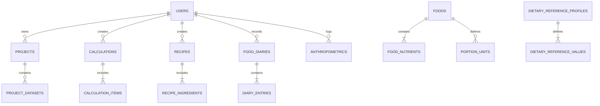

# NutriNexa — Nutrition Research & Analytics

<p align="center">
  
</p>

<p align="center">
  <strong>Connecting Food Science with Better Insights.</strong>
</p>

<p align="center">
  
  
  
  
  
  
  
  
</p>

---

## 🔬 1. Project Overview

**NutriNexa** is an academic-grade, browser-based nutrition calculation, food composition analysis, and dietary research platform. Built for dietitians, nutrition students, food scientists, and academic researchers, NutriNexa provides a unified laboratory environment for:

- **Nutrient Formulations:** Scaled compound nutrient modeling with mathematical transparency.
- **Batch Recipe Modeling:** Cooked yield factors, per-serving portions, and allergen labeling.
- **Dietary Recalls (24h/3-Day):** Benchmark patient and subject food intakes against **US DRI** and **ICMR-NIN 2020** Dietary Reference Values.
- **Anthropometric Indices:** Real-time BMI (WHO TRS 854 & Asian-Pacific standards) and Waist-to-Height Ratio (WHtR) cardiometabolic evaluation.
- **Research Workspace:** Cohort dataset management and real descriptive statistical calculations (Mean, Median, SD, Min, Max, Sample Size N).
- **Publication Reports:** Institutional letterhead reports with print-to-PDF formatting and CSV exports.

---

## 🎨 2. Visual Identity & Brand Palette

The platform follows a clean, scientific, and academic visual identity designed to feel like high-precision laboratory software rather than a generic consumer app:

| Element | Hex Code | Purpose |
| :--- | :--- | :--- |
| **Primary Color** | `#174C3A` | Deep forest green representing biological vitality and academic authority |
| **Secondary Color** | `#2D8C83` | Teal for interactive instrumentation, metrics, and data focus |
| **Accent Color** | `#84CC16` | Muted lime green for target indicators, status badges, and active accents |
| **Canvas Background**| `#F7F9F7` | Off-white laboratory canvas minimizing eye fatigue |
| **Card Surfaces** | `#FFFFFF` | Structured white containers with subtle `#E2E8E2` borders and soft shadows |
| **Typography** | `Inter` | High-contrast, clean sans-serif ensuring legibility across complex scientific tables |

---

## ⚡ 3. Core Analytical Modules

```
NutriNexa Platform
├── 01. Academic Dashboard          -> Personalized metrics, active studies, and provenance audit log
├── 02. Food Composition Database  -> Searchable USDA FDC dataset, 30 nutrients/100g, comparison matrix
├── 03. Nutrient Calculator        -> On-the-fly multi-food scaling, composite density, Atwater energy split
├── 04. Recipe Analysis            -> Batch yield factor, per-serving nutrients, allergen tagging
├── 05. Dietary Assessment         -> Multi-meal recalls, US DRI & ICMR-NIN benchmarks, shortfall/excess flags
├── 06. Meal Planner               -> Weekly/daily schedules with target calorie balancing meters
├── 07. Anthropometric Assessment  -> BMI (WHO/Asian cutoffs), Waist-to-Height Ratio, pediatric safety notices
├── 08. Research Projects          -> Protocol management, cohort datasets, descriptive statistics
├── 09. Reports & Exports          -> Standardized institutional letterhead, print-to-PDF, CSV export
├── 10. My Foods & Recipes         -> User-formulated foods, laboratory items, and custom batches
├── 11. Settings & Standards       -> DRV authority profiles (US DRI, ICMR, EFSA), units, and accounts
└── 12. Help & Documentation       -> Mathematical formulas, Atwater factors, missing-data policy
```

### Module Highlights

#### 🥗 Food Composition Database
- Pre-seeded with curated records from **USDA FoodData Central SR Legacy / Foundation Foods**.
- Standardized per **100 g edible portion** across 30 nutrients (Proximates, Lipids, Minerals, Vitamins).
- Includes **4-way side-by-side comparison matrix** for evaluating nutritional profiles.
- Supports adding custom laboratory-assayed food records with custom portion weights.

#### 🧮 Scientific Nutrient Calculator
- Mathematical scaling:
  $$\text{Nutrient Amount} = \frac{\text{Nutrient Value per 100g} \times \text{Edible Quantity (g)}}{100}$$
- Real-time concentration density per 100g of the resulting composite mixture.
- **Atwater Energy Distribution (% of Total Kcal):**
  - $\text{Protein Kcal} = \text{Protein (g)} \times 4.0$
  - $\text{Carbohydrate Kcal} = \text{Carbohydrate (g)} \times 4.0$
  - $\text{Fat Kcal} = \text{Fat (g)} \times 9.0$
  - $\text{Dietary Fiber Kcal} = \text{Dietary Fiber (g)} \times 2.0$

#### 🍲 Recipe Batch Modeling
- Enter raw ingredient masses, specify recipe servings, and enter measured final cooked weight.
- Automatically calculates **yield factor**, **nutrients per serving**, and **nutrients per 100g prepared yield**.
- Documents potential food allergens and standardized preparation protocols.

#### 📋 Dietary Assessment & Recall Benchmarking
- Organizes 24-hour food recalls into **Breakfast, Lunch, Dinner, Morning Snack, and Evening Snack**.
- Compares subject intake against configured **Dietary Reference Values (DRV / RDA / EAR)**:
  - **Adequate Range:** $\ge 70\%$ of reference target
  - **Potential Shortfall:** $< 70\%$ of reference target
  - **Excessive Intake:** Intake exceeds validated **Tolerable Upper Intake Level (UL)**
- Includes clear academic disclaimers: intended for research screening rather than medical diagnosis.

#### 📏 Anthropometric Assessment
- Evaluates BMI ($\text{kg/m}^2$) against:
  - **WHO International Standard (TRS 854):** Underweight (<18.5), Normal (18.5–24.9), Overweight (25–29.9), Obese (≥30).
  - **WHO Asian-Pacific Cutoffs:** Underweight (<18.5), Normal (18.5–22.9), Overweight (23–27.4), Obese (≥27.5).
- **Waist-to-Height Ratio (WHtR):** $< 0.5$ identifies healthy cardiometabolic range; $\ge 0.5$ indicates elevated risk.
- **Pediatric Safety Notice:** Explicitly flags that subjects under 18 require WHO Growth Standard Z-Scores rather than adult cutoffs.

#### 📊 Research Workspace & Descriptive Statistics
- Organizes research protocols by study code (e.g. `NUTRI-2026-A`).
- Upload study matrices and automatically computes **Mean, Median, Standard Deviation (SD), Minimum, Maximum, and Sample Size (N)** without data fabrication.

#### 🌐 Multilingual Interface & Script Localization (Section 19)
- **12 Full-Platform Languages:**
  1. English — `en`
  2. Malayalam — `ml` (മലയാളം)
  3. Indonesian — `id` (Bahasa Indonesia)
  4. Russian — `ru` (Русский)
  5. Arabic — `ar` (العربية — with complete Right-to-Left RTL mirroring)
  6. Hindi — `hi` (हिन्दी)
  7. Tamil — `ta` (தமிழ்)
  8. Kannada — `kn` (ಕನ್ನಡ)
  9. Telugu — `te` (తెలుగు)
  10. Bengali — `bn` (বাংলা)
  11. French — `fr` (Français)
  12. Spanish — `es` (Español)
- **Native Language Selector:** Clearly visible in both website header and user settings with instant in-place switching without reload or data loss.
- **Full Right-to-Left (RTL) Support:** When Arabic is selected, navigations, form layouts, cards, and toolbars automatically mirror directionally while keeping numbers, chemical symbols, and scientific formulas strictly Left-to-Right (`ltr-only`).
- **Centralized Scientific Glossary:** Standardized nutrition terminology across all 12 dictionaries (Energy, Protein, Total Fat, Saturated Fat, Carbohydrates, Dietary Fiber, Sugars, Micronutrients, Serving Size, Edible Portion, DRI Benchmarks).
- **Multilingual Food Search:** Search foods using regional names and transliterations (e.g., searching for `ഓട്സ്`, `الشوفان`, `Овсянка`, `दूध`, or `Susu` finds the corresponding standardized nutrient record).
- **Multilingual Reports & Exports:** Printable PDF reports and CSV exports support choosing report language independently of interface language.

---

## 🗄️ 4. Database Schema & Architecture

The system utilizes an embedded relational SQLite database with foreign keys, constraints, and audit logging:



### Key Tables
- `users`: Secure PBKDF2-HMAC-SHA256 password hash, salt, role (PI, Researcher, Dietitian, Student), and institution.
- `foods`: Code, scientific name, food group, preparation state, source citation, and data quality grade.
- `food_nutrients`: Standardized amount per 100g, unit, `is_missing` flag, and `is_trace` flag.
- `calculations` & `calculation_items`: Saved multi-food composites and quantity multipliers.
- `recipes` & `recipe_ingredients`: Servings, cooked yield weight, cooking instructions, and allergens.
- `food_diaries` & `diary_entries`: Meal slots, food/recipe links, and reference standard comparisons.
- `anthropometrics`: Subject ID, age, sex, height, weight, waist, hip, BMI, and WHtR.
- `project_datasets`: Quantitative research cohorts with stored descriptive statistical summaries.
- `audit_logs`: Provenance log of all system actions for reproducible science.

---

## 🔒 5. Missing Data vs. Zero Policy

In rigorous nutrition research, **unanalyzed values must never be assumed to be zero (0.0)**. NutriNexa transparently handles three nutritional data states:

1. **Quantified Value:** Validated laboratory assay (e.g. $16.89\text{ g}$ protein).
2. **Trace ($\text{TR}$):** Present below the limit of quantification (LOQ); treated as negligible in summation.
3. **Missing / Not Analyzed ($\text{N/A}$):** Marked with `is_missing: true`. When computing composite mixtures, if any contributing ingredient lacks assay data, a **Data Quality Warning** is displayed in calculation summaries to prevent inaccurate scientific conclusions.

---

## 🚀 6. Installation & Quickstart

### Prerequisites
- **Python 3.11+**
- **Node.js 18+** & **npm 10+**

### Step 1: Clone the Repository
```bash
git clone https://github.com/clemantmathewjiji/NutriNexa-NUTRITION-RESEARCH-ANALYTICS.git
cd NutriNexa-NUTRITION-RESEARCH-ANALYTICS
```

### Step 2: Install Backend Dependencies & Seed Database
```powershell
pip install fastapi uvicorn pydantic pandas
python backend/seed_data.py
```

### Step 3: Build the Frontend Bundle
```powershell
cd frontend
npm install
npm run build
cd ..
```

### Step 4: Launch the Server
```powershell
cd backend
python -m uvicorn main:app --host 127.0.0.1 --port 8000
```

Open your browser and navigate to **[http://127.0.0.1:8000](http://127.0.0.1:8000)**. Both the React SPA and FastAPI backend run concurrently on port `8000`.

---

## 🧪 7. Automated Test Suite

NutriNexa includes an automated unit test suite verifying mathematical scaling, multi-food summation, recipe yields, DRV thresholds, and cryptographic security:

```powershell
python backend/test_calculations.py
```

### Verified Test Cases:
```text
test_single_food_nutrient_scaling .......... OK
test_multi_food_aggregation ................ OK
test_recipe_yield_and_servings ............. OK
test_drv_comparison_shortfall_and_excess ... OK
test_anthropometrics (BMI & WHtR) .......... OK
test_auth_password_hashing (PBKDF2) ........ OK

----------------------------------------------------------------------
Ran 6 tests in 0.117s

OK
```

---

## 🔑 8. Pre-Configured Demonstration Account

| Parameter | Value |
| :--- | :--- |
| **Email** | `demo@nutrinexa.org` |
| **Password** | `NutriNexa2026!` |
| **Role** | Principal Investigator |
| **Institution** | SJCET Palai / Food Science & Cybernetics Lab |

*(Alternatively, click **"One-Click Sign In as Demo Lead Researcher"** in the sign-in modal, or register a new custom account)*

---

## 📚 9. Data Sources & Scientific Citations

- **USDA FoodData Central:** U.S. Department of Agriculture, Agricultural Research Service. *FoodData Central SR Legacy & Foundation Foods* (2019/2023).
- **ICMR-NIN 2020:** Indian Council of Medical Research - National Institute of Nutrition. *Nutrient Requirements and Dietary Reference Intakes for Indians* (2020).
- **US DRI / IOM:** Institute of Medicine, Food and Nutrition Board. *Dietary Reference Intakes for Energy, Carbohydrate, Fiber, Fat, Fatty Acids, Cholesterol, Protein, and Amino Acids*.
- **WHO Anthropometry:** World Health Organization. *Physical Status: The Use and Interpretation of Anthropometry*, WHO Technical Report Series 854 (Geneva, 1995) & *WHO Expert Consultation on Appropriate BMI for Asian Populations* (Lancet, 2004).

---

## 👤 Author & Research Lab

**Dr. Clemant Mathew Jiji**  
*St. Joseph's College of Engineering and Technology (SJCET), Palai*  
Email: [clemantmathewjiji@gmail.com](mailto:clemantmathewjiji@gmail.com)  
GitHub: [@clemantmathewjiji](https://github.com/clemantmathewjiji)

---

<p align="center">
  <sub>NutriNexa — Nutrition Research & Analytics &bull; Designed for Scientific & Academic Rigor &bull; 2026</sub>
</p>
